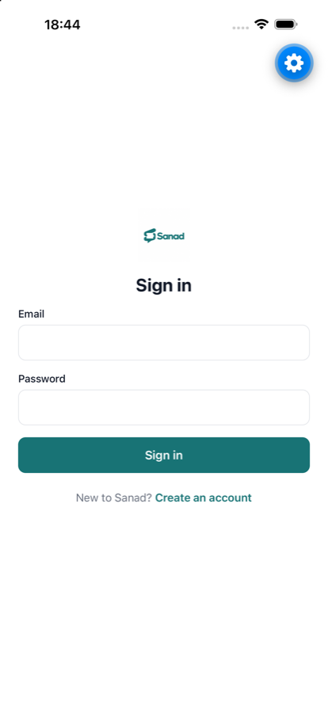
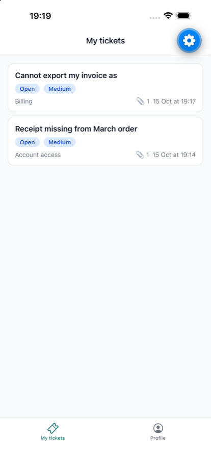
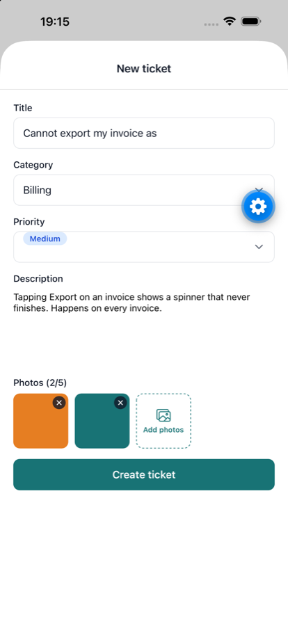
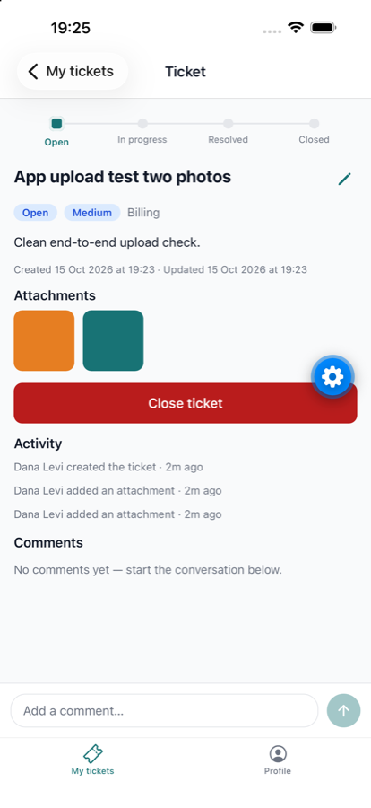

# sanad-mobile

End-user mobile app for **Sanad**, a support-ticket / helpdesk system. Expo · React Native ·
TypeScript · expo-router · TanStack Query.

Built against the contract in [`docs/API.md`](docs/API.md) (a verbatim copy of
`sanad-server/docs/API.md`; the server owns it). Runs against the hosted API out of the box — see
[Try it without running the server](#try-it-without-running-the-server) — or against your own
`sanad-server`. Library and pattern choices are justified in [`docs/DECISIONS.md`](docs/DECISIONS.md).

## Prerequisites

- Node 22
- A device or simulator: **Expo Go** on a physical phone (same Wi-Fi as your computer), or an iOS
  Simulator / Android Emulator
- A running [`sanad-server`](../sanad-server) (defaults to port 4000)

## Try it without running the server

The fastest way to see the app: point it at the hosted `sanad-server` instead of running one
locally.

```sh
cp .env.example .env
```

`.env.example` already defaults `EXPO_PUBLIC_API_URL` to the hosted API:

```
EXPO_PUBLIC_API_URL=https://sanad-server-production-8573.up.railway.app
```

Then skip straight to [Run](#run) below and sign in with the [demo account](#demo-account). No
local server, no LAN IP juggling.

## Environment

`EXPO_PUBLIC_API_URL` is the only variable, and it is public — `EXPO_PUBLIC_*` vars are bundled
into the app, so this is never a secret. It must be reachable **from the device**:

- **Hosted API** (easiest): the Railway URL above works from any simulator or physical phone with
  internet access.
- **Local `sanad-server`**, iOS Simulator / Android Emulator on the same machine: `http://localhost:4000`
  works (Android emulator may need `http://10.0.2.2:4000`).
- **Local `sanad-server`**, physical phone with Expo Go: use your computer's LAN IP, e.g.
  `http://192.168.1.20:4000` — `localhost` on the phone is the phone.

The app fails fast with a readable error if the variable is missing. Never commit `.env`.

## Run

```sh
npm install
npx expo start
```

Then press `i` (iOS Simulator), `a` (Android emulator), or scan the QR code with Expo Go.

Checks used before every commit:

```sh
npx tsc --noEmit
npx expo lint
```

## Demo account

Seeded on both the hosted API and a freshly-seeded local server (`npm run seed` in `sanad-server`):

| | |
|---|---|
| Email | `demo@sanad.demo` |

The password is given out-of-band (the seed script never prints or logs it). Sign in with it
against the hosted API above, or register your own account — either works.

## Screenshots

| Sign in | My tickets |
|---|---|
|  |  |

| Create ticket | Ticket detail |
|---|---|
|  |  |

## Status

Client complete end to end: onboarding, auth, ticket list/detail with status stepper, attachments,
comments and requester status actions, edit-while-open, profile with editable name, and
`sanad://tickets/<id>` deep links through the auth gate. Verified against both a local
`sanad-server` and the hosted instance above.
